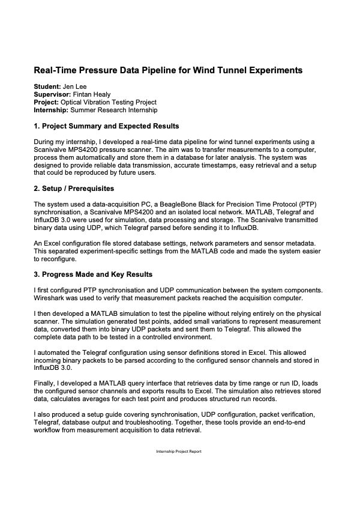

# Wind Tunnel DAQ & Query System

A **MATLAB-based Data Acquisition (DAQ) and Query System** for streaming real-time wind tunnel sensor data via UDP binary packets, processing it with Telegraf, storing it in InfluxDB, and performing time-series analysis.

  

  <a href="./Internship_Project_Report_Jen_Lee.pdf">
    <strong>📄 View Full Internship Project Report (PDF)</strong>
  </a>

## Key Features

### Real-Time DAQ (`main_daq_controller.m`)

- Automatically generates `telegraf.conf` from the Excel configuration.
- Streams real-time test matrix data using UDP (Binary, Little Endian).
- Verifies InfluxDB synchronisation.
- Exports averaged test-point summaries to `wt_run_records.xlsx` (**Sheet1**).

### Data Query Tool (`data_query_tool.m`)

- **Time Range Query** – Exports raw data for a specified time range to **Sheet2**.
- **Run ID Query** – Exports raw data for one or more `run_id`s to **Sheet3**.
- **Dynamic Channels** – Automatically loads channel definitions from the Excel configuration.

---

## File Structure

| File | Description |
|------|-------------|
| `main_daq_controller.m` | Real-time DAQ control, UDP streaming, and run summary export |
| `data_query_tool.m` | Data querying and Excel report generation |
| `telegraf_settings.xlsx` | System settings and sensor metadata |
| `telegraf.conf` | Auto-generated Telegraf configuration |
| `wt_run_records.xlsx` | Output Excel report |

---

## Configuration (`telegraf_settings.xlsx`)

| Sheet | Purpose | Main Parameters |
|------|---------|-----------------|
| **Sheet1** | System & InfluxDB configuration | `InfluxDB_URL`, `Token`, `Org`, `Bucket`, `Telegraf_Port`, etc. |
| **Sheet2** | Experimental test matrix | `Velocity`, `Alpha`, `Lift`, etc. |
| **Sheet3** | Sensor metadata | `Name`, `Type`, `Assignment` (UDP packet layout) |

---

## Output (`wt_run_records.xlsx`)

| Sheet | Generated By | Description |
|------|--------------|-------------|
| **Sheet1** | `main_daq_controller.m` | Averaged summary for each test point |
| **Sheet2** | `data_query_tool.m` | Raw data for a specified time range |
| **Sheet3** | `data_query_tool.m` | Raw data for specified `run_id`s |

---

## Quick Start

1. **Configure**
   - Update InfluxDB credentials in **Sheet1**.
   - Update sensor metadata in **Sheet3**.

2. **Run the DAQ**
   - Execute `main_daq_controller.m`.
   - The script generates `telegraf.conf`, streams UDP data, and exports the run summary.

3. **Query Data**
   - Set `startTime`/`endTime` or `run_ids` in `data_query_tool.m`.
   - Run the script to export results to **Sheet2** or **Sheet3**.

---

## Notes

- **Timezone**
  - InfluxDB queries require **UTC** timestamps.
  - Example: **11:00 BST → 10:00 UTC**.

- **String Padding**
  - String tags such as `run_id` and `test_point` are right-padded with spaces to fixed byte lengths for binary UDP packet parsing.
